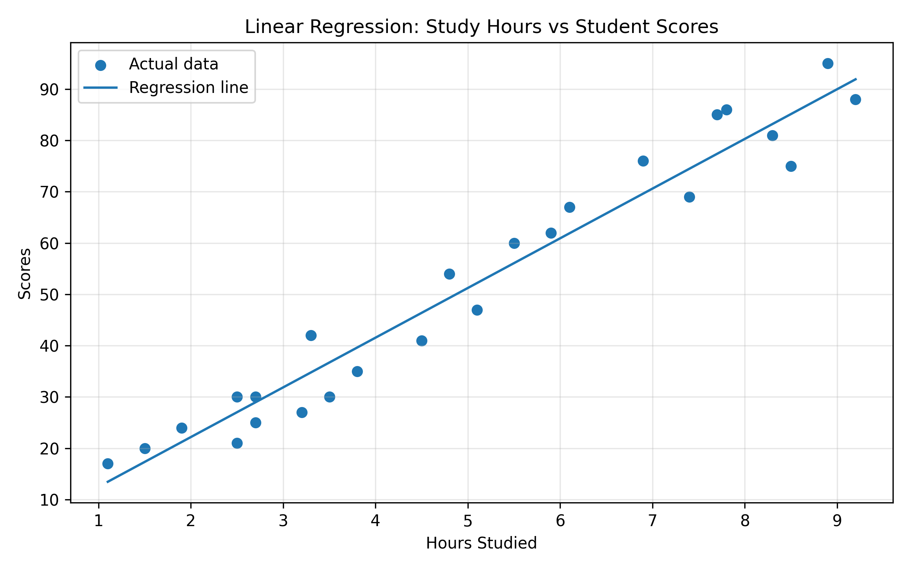

# Student Score Prediction Using Linear Regression

**Fourth Contact Session Assignment**  
**Author:** Damisa Rufai Emmanuel

This project demonstrates how to extract data from a CSV file, inspect and prepare the data, train a Linear Regression model, evaluate its predictions, and visualize the relationship between study hours and student scores.

## Project objective

Use the number of hours a student studies (`Hours`) to predict the student's score (`Scores`) with a simple Linear Regression model.

## Dataset

The dataset is stored in `data/student_scores.csv` and contains 25 observations with two columns:

| Column | Description | Role |
|---|---|---|
| `Hours` | Number of hours studied | Independent variable (X) |
| `Scores` | Score obtained by the student | Dependent variable (y) |

## Project structure

```text
student-score-linear-regression/
├── data/
│   └── student_scores.csv
├── outputs/
│   ├── model_metrics.txt
│   ├── predictions.csv
│   └── regression_plot.png
├── reports/
│   └── Assignment_Report.docx
├── src/
│   ├── __init__.py
│   └── linear_regression.py
├── tests/
│   └── test_analysis.py
├── .gitignore
├── README.md
└── requirements.txt
```

## Requirements

- Python 3.9 or newer
- pip

## Run the project locally

### 1. Clone the repository

```bash
git clone https://github.com/YOUR-USERNAME/student-score-linear-regression.git
cd student-score-linear-regression
```

### 2. Create and activate a virtual environment

**Windows (PowerShell):**

```powershell
python -m venv venv
.\venv\Scripts\Activate.ps1
```

**Linux/macOS:**

```bash
python3 -m venv venv
source venv/bin/activate
```

### 3. Install dependencies

```bash
pip install -r requirements.txt
```

### 4. Run the analysis

```bash
python -m src.linear_regression
```

The program reads the CSV dataset, displays the extracted data and descriptive statistics, trains the model, evaluates it, and writes the results to the `outputs/` directory.

### 5. Run the tests

```bash
pytest -q
```

## Methodology

1. Read the CSV file with pandas.
2. Inspect the first records, dataset information, missing values, and descriptive statistics.
3. Select `Hours` as the independent variable and `Scores` as the dependent variable.
4. Split the data into 80% training data and 20% testing data using `random_state=42`.
5. Train a Scikit-learn `LinearRegression` model.
6. Predict scores for the test data.
7. Evaluate the model with MAE, MSE, RMSE, and R-squared.
8. Plot the observations and fitted regression line.

## Results

The model produced the following results on the specified train/test split:

| Measure | Result |
|---|---:|
| Regression equation | `Score = 2.827 + (9.682 × Hours)` |
| Mean Absolute Error (MAE) | 3.9208 |
| Mean Squared Error (MSE) | 18.9432 |
| Root Mean Squared Error (RMSE) | 4.3524 |
| R-squared (R²) | 0.9678 (96.78%) |

The positive slope indicates that, in this dataset, more study hours are associated with higher scores. The slope estimates an average increase of about 9.68 score points for each additional study hour within the fitted linear relationship. This association does not by itself prove causation.

### Regression visualization



### Generated output files

- `outputs/model_metrics.txt` – model equation and evaluation metrics.
- `outputs/predictions.csv` – actual and predicted scores for the test records.
- `outputs/regression_plot.png` – scatter plot and regression line.

## Conclusion

The project successfully extracts a CSV dataset and applies Linear Regression to model the relationship between study hours and student scores. The model achieved an R-squared score of approximately 96.78% on the selected test split.

**Evaluation limitation:** The dataset has only 25 observations, leaving five observations in the test set. The evaluation metrics can therefore be sensitive to the particular split and should be interpreted cautiously.

## Tools and libraries

Python, pandas, NumPy, Matplotlib, Scikit-learn, and pytest.
